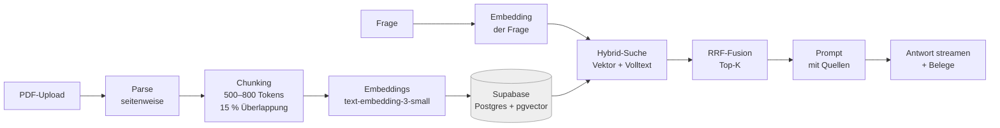

# Notebook

[](https://github.com/leorifa93/notebook/actions/workflows/ci.yml)

Ein NotebookLM-Klon für den Everlast-Consulting-Test: PDFs hochladen, Fragen
stellen, Antworten ausschließlich aus diesen Dokumenten bekommen — jede Aussage
mit klickbarem Beleg inklusive Seitenzahl, der auf genau die Stelle im Original
springt.

Der Anspruch ist nicht "ChatGPT über PDFs", sondern **Nachvollziehbarkeit**:
Wenn Notebook eine Zahl nennt, soll der Reviewer in zwei Klicks sehen, auf
welcher Seite sie steht. Alles in diesem Repo ist um diese eine Eigenschaft
herum gebaut.

> **Stand:** Schritt 2 von 4 — Ingest mit Notebooks. Quellen (PDF, Markdown,
> Text) lassen sich hochladen, landen vollständig mit Seitenzahlen und
> Embeddings in Supabase und erscheinen in der Sidebar, wo man sie an- und
> abwählen oder löschen kann. **Der Chat antwortet noch mit `501`**, er kommt
> in Schritt 3. Was in welchem Schritt dazukommt, steht unter
> [Nächste Schritte](#nächste-schritte).

---

## Architektur



Der Weg in Worten:

1. **Parse** — `lib/pdf.ts` liest das PDF mit `unpdf` und gibt den Text
   *je Seite* zurück. Seiten werden nie zusammengeführt.
2. **Chunk** — `lib/chunk.ts` zerlegt jede Seite in Abschnitte von 500–800
   Tokens mit ~15 % Überlappung. Chunks überschreiten keine Seitengrenze.
3. **Embed** — `lib/embeddings.ts` erzeugt Vektoren (1536 Dimensionen).
4. **Store** — `db/schema.sql`: `documents` + `chunks`, Embeddings als
   `vector(1536)` mit HNSW-Index.
5. **Retrieve** — `lib/retrieval.ts` sucht hybrid: Vektorsuche und deutsche
   Volltextsuche, fusioniert per Reciprocal Rank Fusion.
6. **Answer** — `lib/prompt.ts` baut den Prompt mit nummerierten Quellen; das
   Modell muss jede Aussage mit `[n]` belegen.

**Wichtige Dateien**

| Pfad | Zweck |
| --- | --- |
| `db/schema.sql` | Tabellen, pgvector, HNSW- und GIN-Index, Cascade |
| `lib/db.ts` | einziger Ort mit `pg`; Pool, `query()`, Transaktionen |
| `lib/pdf.ts` | seitenweises Parsing, Scan-Erkennung |
| `lib/chunk.ts` | Chunking mit Überlappung, Token-Schätzung |
| `lib/embeddings.ts` | Embeddings in Batches |
| `lib/retrieval.ts` | Hybrid-Suche + RRF, fertiges SQL |
| `lib/prompt.ts` | Systemprompt, Quellenblöcke, Beleg-Extraktion |
| `lib/env.ts` | alle Env-Zugriffe, lazy geprüft |
| `lib/ingest.ts` | Upload prüfen, lesen, zerlegen, einbetten, speichern |
| `lib/documents.ts` | Dokumente schreiben (eine Transaktion), listen, löschen |
| `lib/rate-limit.ts` | Rate-Limit pro IP, gezählt in Postgres |
| `lib/limits.ts` | Upload-Grenzen, geteilt von Server und Client |
| `app/api/ingest/route.ts` | Upload-Endpoint |
| `app/api/documents/` | Quellen listen (`GET`) und löschen (`DELETE /:id`) |
| `app/api/chat/route.ts` | Chat-Endpoint (Gerüst, `501` bis Schritt 3) |
| `components/workspace.tsx` | Client-Zustand: Quellen, Auswahl, Upload, Löschen |
| `fixtures/` | eigene CC0-Testdokumente (Muster-Mietvertrag, Scan-Beispiel) |

---

## Was Schritt 2 kann

**Notebooks.** Quellen gehören zu einem Notebook, wie in NotebookLM. Die Demo
hat genau eins, „Demo“, mit fester ID aus `db/schema.sql`; einen
Notebook-Umschalter gibt es bewusst nicht. Die Ebene kommt trotzdem jetzt,
weil sie später nachzurüsten eine Migration auf bereits hochgeladenen Daten
wäre. In der Sidebar ist jede Quelle per Checkbox an- und abwählbar; diese
Auswahl geht in Schritt 3 als `documentIds` an den Chat. Neue Quellen sind
automatisch ausgewählt.

**Upload.** `POST /api/ingest` nimmt PDF, Markdown und reinen Text, liest
PDFs seitenweise, zerlegt in Chunks, erzeugt Embeddings und schreibt
Dokument, Originaldatei (`bytea`) und Chunks in **einer** Transaktion.
Antwort `201` mit `{ id, title, sourceType, pageCount, chunkCount }`.
Markdown und Text haben keine Seiten, ihre Chunks tragen `page = null` statt
einer erfundenen Seitenzahl.

**Grenzen und Fehler** — alle Meldungen deutsch, ohne Stacktrace:

| Fall | Antwort |
| --- | --- |
| Datei über 4 MB | `413` (Vercel schneidet bei ~4,5 MB ab; der Client prüft vorab) |
| PDF über 40 Seiten | `413`, geprüft vor der Textextraktion |
| mehr als 200 Abschnitte, auch bei Text und Markdown | `413`, vor den Embeddings |
| Office, Bilder, HTML, CSV | `415` |
| Scan-PDF oder Datei ohne Text | `422` (kein OCR, siehe Nicht-Ziele) |
| leere oder kaputte Datei | `400` |
| dieselbe Datei schon im Notebook | `409`, ohne erneut einzubetten |
| mehr als 8 Uploads pro 15 Minuten und IP | `429` mit `Retry-After` |
| Embedding-Dienst nicht erreichbar | `502`, nichts gespeichert |

**Warum das Rate-Limit schon jetzt.** Die Demo hat keinen Login, und ab
diesem Schritt ist der Embedding-Pfad öffentlich. Gezählt wird in Postgres
(`rate_limit_events`) statt in einem externen Dienst: kein neuer Account,
kein neuer Key.

**Warum Row Level Security.** Supabase veröffentlicht jede Tabelle in
`public` über seine REST-API, und der `anon`-Key ist dort nicht geheim. Die
App nutzt diese API nicht, sie spricht über `pg` als Tabellenbesitzer. RLS
ohne Policies sperrt deshalb nur die REST-API aus.

---

## Technische Entscheidungen

### Warum Supabase und pgvector statt einer eigenen Vektordatenbank

Supabase ist der Datenbank-Stack dieses Projekts — Postgres mit pgvector,
ohne eigenen Betrieb. Chunks, Seitenzahlen und Vektoren liegen in derselben
Zeile. Eine Suche ist damit ein `JOIN` statt einer zweiten Datenhaltung, die
mit Postgres synchron gehalten werden müsste — und genau diese
Synchronisation ist die Quelle der meisten „Beleg zeigt auf falsche
Seite"-Fehler. Bei einem Dokumentenbestand dieser Größe ist HNSW in Postgres
schnell genug; eine eigene Vektordatenbank wie Pinecone oder Weaviate wäre ein
zusätzlicher Dienst, ein zusätzlicher Key und eine zusätzliche Stelle, an der
die Live-Demo ausfallen kann.

### Warum Seitenzahl als Metadatum am Chunk

Der Beleg ist nur dann ehrlich, wenn er auf die Seite zeigt, auf der die
Aussage wirklich steht. Deshalb wird der Text seitenweise geparst und die
Seitenzahl an jeden Chunk geschrieben; ein Chunk überschreitet keine
Seitengrenze. Der Preis sind gelegentlich kurze Chunks (ein Deckblatt ergibt
einen Chunk mit 10 Tokens) — das ist deutlich billiger als ein Beleg, der ins
Leere springt.

### Warum Hybrid-Suche statt nur Embeddings

Embeddings finden Bedeutung: "Kündigungsfrist" matcht "Vertrag endet nach drei
Monaten". Sie versagen aber bei exakten Zeichenketten — Paragrafennummern,
Beträgen, Namen, Aktenzeichen. Die Volltextsuche mit deutschem Stemming ist
genau dafür der Gegenpol. Beide Listen werden per Reciprocal Rank Fusion
kombiniert: Das Verfahren braucht keine Kalibrierung der unterschiedlichen
Score-Skalen und ist in einem Satz erklärbar. In den Tests dieses Repos
landete der richtige Chunk dadurch auf Platz 1, obwohl die Vektorsuche ihn
allein nicht gefunden hätte.

### Warum Streaming

Die erste Zeile steht nach ~500 ms statt nach 8 Sekunden. Bei einer
Live-Demo ist das der Unterschied zwischen "funktioniert" und "hängt". Die
Belegliste wird vor dem Textstream geschickt, damit die Quellenkarten schon
stehen, während die Antwort noch tippt.

---

## Lokales Setup

Voraussetzungen: Node.js 20+ und ein Supabase-Projekt (kostenloser Plan
genügt).

**1. Abhängigkeiten**

```bash
npm ci
```

**2. Supabase-Projekt anlegen**

Auf [supabase.com](https://supabase.com) ein neues Projekt anlegen. Region
`eu-central-1` (Frankfurt) ist für eine Demo in Deutschland die naheliegende
Wahl — kürzere Wege, und die Daten bleiben in der EU. Das Datenbank-Passwort
beim Anlegen vergeben und **sofort sichern**: Supabase zeigt es nur einmal.

pgvector ist in Supabase vorinstalliert, ein eigenes Datenbank-Setup entfällt.

**3. Schema einspielen**

Das Skript ist idempotent und kann gefahrlos erneut laufen. **Nach jedem
Schritt, der `db/schema.sql` ändert, erneut ausführen** — Schritt 2 ergänzt
Notebooks, Dateiinhalt, Duplikatschutz, Rate-Limit-Tabelle und RLS.

Bequemster Weg: Inhalt von `db/schema.sql` im Supabase-Dashboard unter
**SQL Editor** einfügen und ausführen.

Alternativ über die direkte Verbindung (nicht den Pooler — PgBouncer
versteht manche DDL-Statements nicht):

```bash
psql "$DIRECT_DATABASE_URL" -f db/schema.sql
```

**4. Konfiguration**

```bash
cp .env.example .env.local
```

In `.env.local` zwei Werte eintragen:

- `DATABASE_URL` — aus Supabase unter **Project Settings → Database →
  Connection string → URI**. Für die App den **Pooler-Port 6543** nehmen,
  nicht 5432: serverlose Functions öffnen viele kurze Verbindungen, und der
  Pooler davor ist genau dafür da.
- `OPENAI_API_KEY` — ein Key mit monatlichem Ausgabenlimit
  (`platform.openai.com` → Settings → Limits).

Beide Werte gehören später in Vercel unter **Settings → Environment
Variables** (Production und Preview), nicht ins Repo. `.env.local` steht in
`.gitignore`.

Meldet die App auf Vercel `self-signed certificate in certificate chain`,
liegt das an `sslmode=require` in der URL: `pg` behandelt das inzwischen
wie `verify-full`. Dann `sslmode=require` durch
`uselibpqcompat=true&sslmode=require` ersetzen. Das ist von dieser
Entwicklungsmaschine aus nicht geprüft, weil sie keine Postgres-Ports
erreicht.

**5. Starten**

```bash
npm run dev          # http://localhost:3000
```

Zum Ausprobieren `fixtures/muster-mietvertrag.pdf` hochladen: sechs Seiten
mit bekannten Antworten auf bekannten Seiten (siehe
[`fixtures/README.md`](fixtures/README.md)). Die Demo startet absichtlich
leer, ein Seed beim Deploy bräuchte den OpenAI-Key in der CI.

**Prüfen, ob alles baut und läuft**

```bash
npm run test         # vitest: 100 Tests, ~4 s, inkl. Postgres via PGlite
npm run typecheck    # tsc --noEmit
npm run build        # next build
npm run lint
```

Alle vier laufen **ohne** `DATABASE_URL` und ohne `OPENAI_API_KEY` durch: jeder
Env-Zugriff ist in `lib/env.ts` gekapselt und wird erst beim Aufruf
ausgewertet, nie beim Import. Die Datenbank-Tests laufen gegen
[PGlite](https://pglite.dev) mit pgvector, also echtes Postgres im
Testprozess, mit genau `db/schema.sql`. Gestubbt sind nur die Embeddings
(deterministisch, normalisiert). Deshalb lässt sich der Build auch in einer
frischen CI ohne Supabase-Zugang prüfen. Die GitHub-Action in
`.github/workflows/ci.yml` führt bei jedem Pull Request und bei jedem
Push auf `main` genau diese vier Befehle aus.

---

## Bewusste Nicht-Ziele

Diese Dinge sind absichtlich nicht gebaut. Ein Testprojekt, das alles halb
kann, ist schwächer als eines, das einen Kern ganz kann — und jedes zusätzliche
Feature ist eine zusätzliche Stelle, an der die Live-Demo brechen kann.

- **Keine Authentifizierung.** Die Demo-Instanz ist offen. Es gibt keine
  Nutzerkonten, keine Sessions, keine Rechteprüfung.
- **Keine Audio-Overview.** NotebookLM kann daraus Podcasts generieren. Das
  ist ein eigener Dienst, teuer und langsam, und trägt nichts zur
  Kernfrage bei: "Stimmt die Antwort und wo steht sie?"
- **Keine Multi-User-Verwaltung.** Kein Teilen, keine Rollen, kein
  Team-Workspace. Ein Dokument gehört allen.
- **Kein Notebook-Umschalter.** Die Datenbank kennt Notebooks, die Demo zeigt
  genau eins. Mehrere Notebooks anlegen und wechseln ist UI-Arbeit ohne
  Erkenntnisgewinn für die Kernfrage.
- **Löschen ist offen.** Ohne Login kann jeder Besucher Quellen der Demo
  entfernen. Das ist der Preis der offenen Demo; das Rate-Limit schützt nur
  den teuren Pfad (Embeddings).
- **Keine Vektor-Dimension > 1536.** Ein anderes Embedding-Modell erfordert
  eine Schema-Migration plus Re-Embedding, nicht nur eine Env-Änderung.
- **Kein OCR.** Gescannte PDFs werden erkannt (`probablyScanned`) und offen
  abgelehnt statt stillschweigend leere Antworten zu liefern.

---

## Nächste Schritte

- [x] **Schritt 1 — Gerüst.** Next.js, Tailwind, shadcn-Primitives,
      Datenmodell, Retrieval- und Prompt-Logik, Doku.
- [x] **Schritt 2 — Ingest.** Upload von PDF, Markdown und Text bis ins
      Schema, eine Transaktion pro Quelle, Notebook „Demo“ mit
      an-/abwählbaren Quellen, Limits, Duplikatschutz, Rate-Limit, RLS,
      CC0-Fixtures. Plan: [`docs/schritt-2-plan.md`](docs/schritt-2-plan.md),
      Review: [`docs/review-schritt-2.md`](docs/review-schritt-2.md).
- [ ] **Schritt 3 — Chat.** `retrieve` → `streamText` mit der Quellenauswahl
      als `documentIds`, Belege im UI als Karten mit Seitenzahl und Sprung
      ins PDF (die Datei liegt seit Schritt 2 in `documents.file_bytes`);
      Verweigerungstext; Auto-Zusammenfassung und Fragevorschläge nach dem
      Upload; Rate-Limit am Chat.
- [ ] **Schritt 4 — Eval + Feinschliff.** Eval-Set aus `docs/eval-plan.md`
      implementieren, Trefferquote messen und im README nennen, Loom-Video.

Ein Eval-Set ist der stärkste einzelne Baustein für den Reviewer, weil es
zeigt, dass die Pipeline messbar ist und nicht nur gefühlt funktioniert —
Konzept in [`docs/eval-plan.md`](docs/eval-plan.md).

---

## Lizenz / Kontext

Testprojekt im Bewerbungsverfahren. Keine produktive Nutzung vorgesehen.
