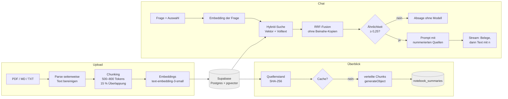

# Notebook

[](https://github.com/leorifa93/notebook/actions/workflows/ci.yml)

Ein NotebookLM-Klon für den Everlast-Consulting-Test: PDFs hochladen, Fragen
stellen, Antworten ausschließlich aus diesen Dokumenten bekommen — jede Aussage
mit klickbarem Beleg inklusive Seitenzahl, der auf genau die Stelle im Original
springt.

Der Anspruch ist nicht "ChatGPT über PDFs", sondern **Nachvollziehbarkeit**:
Wenn Notebook eine Zahl nennt, soll der Reviewer in zwei Klicks sehen, auf
welcher Seite sie steht. Alles in diesem Repo ist um diese eine Eigenschaft
herum gebaut.

> **Stand:** Schritt 3 von 4 abgeschlossen: Chat mit Belegen. Quellen (PDF,
> Markdown, Text) hochladen, Fragen an die angehakten Quellen stellen,
> gestreamte Antworten mit klickbaren Belegen und Sprung auf die Seite im
> Original, ehrliche Absage, wenn es nicht in den Quellen steht, dazu ein
> belegter Überblick mit drei Fragevorschlägen. Noch offen ist Schritt 4:
> Eval mit gemessener Trefferquote. Eine solche Zahl gibt es deshalb hier
> noch nicht.
>
> **Live:** <https://notebook-coral-seven.vercel.app> (offene Demo ohne
> Login, siehe [Bekannte Grenzen](#bekannte-grenzen)).

---

## Architektur



Der Weg in Worten:

1. **Parse.** `lib/pdf.ts` liest das PDF mit `unpdf` *je Seite*, verwirft
   doppelt gezeichneten Text (L2) und bereinigt ihn mit `lib/text.ts`
   (Steuerzeichen, unsichtbare Zeichen, NFC).
2. **Chunk.** `lib/chunk.ts` zerlegt jede Seite in Abschnitte von 500–800
   Tokens mit ~15 % Überlappung. Kein Chunk überschreitet eine Seitengrenze,
   keiner wird abgeschnitten.
3. **Embed und Store.** `lib/embeddings.ts` erzeugt Vektoren mit 1536
   Dimensionen. Dokument, Originaldatei und Chunks schreibt
   `lib/documents.ts` in einer Transaktion (`db/schema.sql`, HNSW-Index).
4. **Retrieve.** `lib/retrieval.ts` sucht hybrid: Vektorsuche und deutsche
   Volltextsuche in *einer* SQL-Abfrage, fusioniert per Reciprocal Rank
   Fusion. Fast gleiche Treffer desselben Dokuments fallen heraus.
5. **Absage oder Antwort.** Liegt der beste Vektortreffer unter
   `MIN_SIMILARITY`, kommt die Absage ohne Modellaufruf. Sonst baut
   `lib/prompt.ts` den Prompt mit nummerierten Quellen, und das Modell
   muss jede Aussage mit `[n]` belegen.
6. **Stream.** `POST /api/chat` schickt zuerst die Belegliste und dann den
   Text. Das UI macht aus `[n]` einen Knopf, der die Belegkarte öffnet.
7. **Überblick.** `GET`/`POST /api/summary` fasst alle Quellen des Notebooks
   belegt zusammen und schlägt drei Fragen vor, gecacht pro Quellenstand.

**Wichtige Dateien**

| Pfad | Zweck |
| --- | --- |
| `db/schema.sql` | Tabellen, pgvector, HNSW- und GIN-Index, Cascade |
| `db/migrations/` | Nachträge für bestehende Datenbanken (SQL-Editor) |
| `lib/db.ts` | einziger Ort mit `pg`; Pool, `query()`, Transaktionen |
| `lib/pdf.ts` | seitenweises Parsing, Scan-Erkennung, doppelter Text (L2) |
| `lib/text.ts` | Textbereinigung für Inhalt, Titel und Frage |
| `lib/chunk.ts` | Chunking mit Überlappung, Token-Schätzung |
| `lib/embeddings.ts` | Embeddings in Batches |
| `lib/retrieval.ts` | Hybrid-Suche + RRF, fertiges SQL, Beinahe-Kopien |
| `lib/prompt.ts` | Systemprompts, Quellenblöcke, Belege und Ausschnitt |
| `lib/chat.ts` | Grenzen und Meldungen des Chats, Absage-Schwelle |
| `lib/errors.ts` | Fehler einordnen: Konfiguration, Guthaben, vorübergehend |
| `lib/env.ts` | alle Env-Zugriffe, lazy geprüft |
| `lib/ingest.ts` | Upload prüfen, lesen, zerlegen, einbetten, speichern |
| `lib/documents.ts` | Dokumente schreiben (eine Transaktion), listen, löschen |
| `lib/rate-limit.ts` | Rate-Limit pro IP, gezählt in Postgres |
| `lib/summary.ts`, `lib/summary-store.ts` | Zusammenfassung: Auswahl der Chunks, Prüfung, Cache pro Quellenstand |
| `lib/limits.ts` | Upload-Grenzen, geteilt von Server und Client |
| `app/api/ingest/route.ts` | Upload-Endpoint |
| `app/api/documents/` | Quellen listen (`GET`) und löschen (`DELETE /:id`) |
| `app/api/chat/route.ts` | Chat: Frage an die angehakten Quellen, Antwort als Stream mit Belegliste vorweg |
| `app/api/documents/[id]/file/` | Originaldatei für „Im Original öffnen, Seite N“ |
| `app/api/summary/route.ts` | Zusammenfassung und drei Fragevorschläge (`GET` Cache, `POST` erzeugen) |
| `components/workspace.tsx` | Client-Zustand: Quellen, Auswahl, Upload, Löschen |
| `components/chat.tsx`, `chat-answer.tsx` | Chat, Antwort mit Belegknöpfen und Belegkarte |
| `components/notebook-overview.tsx` | Überblick und Fragevorschläge im leeren Chat |
| `fixtures/` | eigene CC0-Testdokumente (Muster-Mietvertrag, Scan, Duplikate, leeres PDF) |

---

## Was Notebook kann

**Quellen hochladen.** PDF, Markdown und reiner Text bis 4 MB. PDFs werden
seitenweise gelesen, Markdown und Text haben keine Seiten, ihre Chunks
tragen `page = null` statt einer erfundenen Seitenzahl. Dokument,
Originaldatei (`bytea`) und Chunks landen in **einer** Transaktion. Die
Quellen gehören zum Notebook „Demo“ (feste ID aus `db/schema.sql`), sind in
der Sidebar per Checkbox an- und abwählbar und lassen sich löschen.

**Fragen mit Belegen.** Eine Frage geht mit den angehakten Quellen an
`POST /api/chat`. Die Suche ist hybrid: Vektorsuche für Bedeutung und
deutsche Volltextsuche für exakte Begriffe, fusioniert per RRF. Jede
Aussage trägt einen Beleg `[n]`, höchstens zwei pro Aussage. Ein Klick
öffnet eine Karte mit Titel, Seite und dem Ausschnitt, der am besten zur
Frage passt, dazu „Im Original öffnen, Seite N“ mit Sprung auf die Seite.

**Ehrliche Absage.** Passt kein Treffer (beste Ähnlichkeit unter 0,25),
antwortet Notebook „Das steht nicht in den bereitgestellten Quellen.“, ohne
das Modell zu fragen. Findet die Suche etwas, das die Frage nicht
beantwortet, verlangt der Systemprompt dieselbe Absage.

**Überblick und Fragevorschläge.** Im leeren Chat steht eine kurze, belegte
Zusammenfassung aller Quellen mit drei Fragen, die sich damit beantworten
lassen. Ein Klick stellt die Frage. Erzeugt wird einmal pro Quellenstand
(SHA-256 über die Inhalte), danach kommt sie aus dem Cache. Upload und
Löschen machen den Cache von selbst ungültig.

**Rate-Limits** pro IP, gezählt in Postgres (`rate_limit_events`), Antwort
`429` mit `Retry-After`:

| Endpoint | Grenze | gezählt |
| --- | --- | --- |
| Upload | 8 / 15 min | jeder angenommene Upload |
| Chat | 20 / 15 min | jede gültige Frage, auch eine Absage (sie kostet ein Embedding) |
| Zusammenfassung | 6 / 15 min | nur, wenn kein Cache passt |

**Fehlermeldungen** sind deutsch, ohne Stacktrace, und raten nur dann zu
einem neuen Versuch, wenn Warten hilft:

| Fall | Antwort |
| --- | --- |
| Datei über 4 MB, PDF über 40 Seiten, mehr als 200 Abschnitte | `413`, vor Textextraktion bzw. Embeddings |
| Office, Bilder, HTML, CSV | `415` |
| Scan-PDF, leeres PDF, Textdatei ohne Text oder nicht UTF-8 | `422` (kein OCR, siehe Nicht-Ziele) |
| leere oder kaputte Datei, leere Frage, keine Quelle ausgewählt | `400` |
| dieselbe Datei schon im Notebook | `409`, ohne erneut einzubetten |
| Key fehlt oder falsch, Guthaben leer, Schema oder Migration fehlt, falsches DB-Passwort | `503`, „nicht vollständig eingerichtet“ bzw. Guthaben, ohne Retry-Hinweis |
| OpenAI nicht erreichbar | `502` mit Retry-Hinweis, beim Upload wird nichts gespeichert |
| Antwort dauert über 45 s | Abbruch mit eigener Meldung (Zusammenfassung: `504`) |

**Warum Row Level Security.** Supabase veröffentlicht jede Tabelle in
`public` über seine REST-API, und der `anon`-Key ist dort nicht geheim. Die
App nutzt diese API nicht, sie spricht über `pg` als Tabellenbesitzer. RLS
ohne Policies sperrt deshalb nur die REST-API aus.

---

## Technische Entscheidungen

### Warum Supabase und pgvector statt einer eigenen Vektordatenbank

Supabase ist der Datenbank-Stack dieses Projekts — Postgres mit pgvector,
ohne eigenen Betrieb. Chunks, Seitenzahlen und Vektoren liegen in derselben
Zeile. Eine Suche ist damit ein `JOIN` statt einer zweiten Datenhaltung, die
mit Postgres synchron gehalten werden müsste — und genau diese
Synchronisation ist die Quelle der meisten „Beleg zeigt auf falsche
Seite"-Fehler. Bei einem Dokumentenbestand dieser Größe ist HNSW in Postgres
schnell genug; eine eigene Vektordatenbank wie Pinecone oder Weaviate wäre ein
zusätzlicher Dienst, ein zusätzlicher Key und eine zusätzliche Stelle, an der
die Live-Demo ausfallen kann.

### Warum Seitenzahl als Metadatum am Chunk

Der Beleg ist nur dann ehrlich, wenn er auf die Seite zeigt, auf der die
Aussage wirklich steht. Deshalb wird der Text seitenweise geparst und die
Seitenzahl an jeden Chunk geschrieben; ein Chunk überschreitet keine
Seitengrenze. Der Preis sind gelegentlich kurze Chunks (ein Deckblatt ergibt
einen Chunk mit 10 Tokens) — das ist deutlich billiger als ein Beleg, der ins
Leere springt.

### Warum Hybrid-Suche statt nur Embeddings

Embeddings finden Bedeutung: "Kündigungsfrist" matcht "Vertrag endet nach drei
Monaten". Sie versagen aber bei exakten Zeichenketten — Paragrafennummern,
Beträgen, Namen, Aktenzeichen. Die Volltextsuche mit deutschem Stemming ist
genau dafür der Gegenpol. Beide Listen werden per Reciprocal Rank Fusion
kombiniert: Das Verfahren braucht keine Kalibrierung der unterschiedlichen
Score-Skalen und ist in einem Satz erklärbar. In den Tests dieses Repos
landete der richtige Chunk dadurch auf Platz 1, obwohl die Vektorsuche ihn
allein nicht gefunden hätte.

### Warum Streaming

Die erste Zeile steht nach ~500 ms statt nach 8 Sekunden. Bei einer
Live-Demo ist das der Unterschied zwischen "funktioniert" und "hängt". Die
Belegliste wird vor dem Textstream geschickt, damit die Quellenkarten schon
stehen, während die Antwort noch tippt.

---

## Lokales Setup

Voraussetzungen: Node.js 20+ und ein Supabase-Projekt (kostenloser Plan
genügt).

**1. Abhängigkeiten**

```bash
npm ci
```

**2. Supabase-Projekt anlegen**

Auf [supabase.com](https://supabase.com) ein neues Projekt anlegen. Region
`eu-central-1` (Frankfurt) ist für eine Demo in Deutschland die naheliegende
Wahl — kürzere Wege, und die Daten bleiben in der EU. Das Datenbank-Passwort
beim Anlegen vergeben und **sofort sichern**: Supabase zeigt es nur einmal.

pgvector ist in Supabase vorinstalliert, ein eigenes Datenbank-Setup entfällt.

**3. Schema einspielen**

Das Skript ist idempotent und kann gefahrlos erneut laufen. **Nach jedem
Schritt, der `db/schema.sql` ändert, erneut ausführen.** Für eine neue
Datenbank genügt dieses eine Skript, die Migrationen darunter sind darin
schon enthalten.

Bequemster Weg: Inhalt von `db/schema.sql` im Supabase-Dashboard unter
**SQL Editor** einfügen und ausführen.

Läuft die Datenbank schon mit einem älteren Stand, reichen die einzelnen
Nachträge unter `db/migrations/`, ebenfalls im SQL-Editor und mehrfach
ausführbar:

| Datei | Bringt | Ohne sie |
| --- | --- | --- |
| `db/migrations/2026-11-10-notebook-summaries.sql` | Tabelle `notebook_summaries` (Cache für Zusammenfassung und Fragevorschläge) | Der Überblick im leeren Chat meldet „nicht vollständig eingerichtet“ (503); Quellen und Chat laufen weiter |

Alternativ über die direkte Verbindung (nicht den Pooler — PgBouncer
versteht manche DDL-Statements nicht):

```bash
psql "$DIRECT_DATABASE_URL" -f db/schema.sql
```

**4. Konfiguration**

```bash
cp .env.example .env.local
```

In `.env.local` zwei Werte eintragen:

- `DATABASE_URL`: aus Supabase unter **Project Settings → Database →
  Connection string → URI**. Für die App den **Pooler-Port 6543** nehmen,
  nicht 5432: serverlose Functions öffnen viele kurze Verbindungen, und der
  Pooler davor ist genau dafür da. Am Ende der URL
  `?uselibpqcompat=true&sslmode=require`, also im Format

  ```text
  postgresql://postgres.<projekt-ref>:<passwort>@aws-0-<region>.pooler.supabase.com:6543/postgres?uselibpqcompat=true&sslmode=require
  ```

  Ohne `uselibpqcompat=true` behandelt `pg` `sslmode=require` wie
  `verify-full` und scheitert an der Zertifikatskette des Poolers mit
  `self-signed certificate in certificate chain` (die App meldet dann 503).
- `OPENAI_API_KEY`: ein Key mit monatlichem Ausgabenlimit
  (`platform.openai.com` → Settings → Limits).
- optional `CHAT_MODEL` (Standard `gpt-4o-mini`), gilt für Chat und
  Zusammenfassung.

Diese Werte gehören in Vercel unter **Settings → Environment Variables**
(Production und Preview), nicht ins Repo. `.env.local` steht in
`.gitignore`.

**5. Starten**

```bash
npm run dev          # http://localhost:3000
```

Zum Ausprobieren `fixtures/muster-mietvertrag.pdf` hochladen: sechs Seiten
mit bekannten Antworten auf bekannten Seiten (siehe
[`fixtures/README.md`](fixtures/README.md)). Die Demo startet absichtlich
leer, ein Seed beim Deploy bräuchte den OpenAI-Key in der CI.

**Prüfen, ob alles baut und läuft**

```bash
npm run test         # vitest: 285 Tests in 19 Dateien, ~10 s, inkl. Postgres via PGlite
npm run typecheck    # tsc --noEmit
npm run build        # next build
npm run lint
```

Alle vier laufen **ohne** `DATABASE_URL` und ohne `OPENAI_API_KEY` durch: jeder
Env-Zugriff ist in `lib/env.ts` gekapselt und wird erst beim Aufruf
ausgewertet, nie beim Import. Die Datenbank-Tests laufen gegen
[PGlite](https://pglite.dev) mit pgvector, also echtes Postgres im
Testprozess, mit genau `db/schema.sql`. Gestubbt sind nur die Embeddings
(deterministisch, normalisiert). Deshalb lässt sich der Build auch in einer
frischen CI ohne Supabase-Zugang prüfen. Die GitHub-Action in
`.github/workflows/ci.yml` führt bei jedem Pull Request und bei jedem
Push auf `main` genau diese vier Befehle aus.

---

## Bewusste Nicht-Ziele

Diese Dinge sind absichtlich nicht gebaut. Ein Testprojekt, das alles halb
kann, ist schwächer als eines, das einen Kern ganz kann — und jedes zusätzliche
Feature ist eine zusätzliche Stelle, an der die Live-Demo brechen kann.

- **Keine Authentifizierung.** Die Demo-Instanz ist offen. Es gibt keine
  Nutzerkonten, keine Sessions, keine Rechteprüfung.
- **Keine Audio-Overview.** NotebookLM kann daraus Podcasts generieren. Das
  ist ein eigener Dienst, teuer und langsam, und trägt nichts zur
  Kernfrage bei: "Stimmt die Antwort und wo steht sie?"
- **Keine Multi-User-Verwaltung.** Kein Teilen, keine Rollen, kein
  Team-Workspace. Ein Dokument gehört allen.
- **Kein Notebook-Umschalter.** Die Datenbank kennt Notebooks, die Demo zeigt
  genau eins. Mehrere Notebooks anlegen und wechseln ist UI-Arbeit ohne
  Erkenntnisgewinn für die Kernfrage.
- **Löschen ist offen.** Ohne Login kann jeder Besucher Quellen der Demo
  entfernen. Das ist der Preis der offenen Demo; das Rate-Limit schützt nur
  den teuren Pfad (Embeddings).
- **Keine Vektor-Dimension > 1536.** Ein anderes Embedding-Modell erfordert
  eine Schema-Migration plus Re-Embedding, nicht nur eine Env-Änderung.
- **Kein OCR.** Gescannte PDFs werden erkannt (`probablyScanned`) und offen
  abgelehnt statt stillschweigend leere Antworten zu liefern.
- **Kein Chat-Verlauf.** Jede Frage geht einzeln an den Server, ohne die
  vorigen Antworten im Prompt, und der Verlauf ist nach einem Reload weg.
  Ein Verlauf im Prompt verwässert „nur aus den Quellen“, und Folgefragen
  bräuchten einen eigenen Umformulierungsschritt.
- **Kein eigener PDF-Viewer.** „Im Original öffnen, Seite N“ an der
  Belegkarte öffnet die Datei im PDF-Viewer des Browsers mit `#page=N`.
  Chrome, Edge und Firefox springen auf die Seite; **Safari ignoriert den
  Anker** und zeigt Seite 1. Ein eingebetteter pdf.js-Viewer mit Markierung
  der Fundstelle wäre ein neues Paket samt Worker für einen Browser.

---

## Bekannte Grenzen

Was gebaut ist, aber nicht so gut, wie es sein könnte. Die Kürzel verweisen
auf [`docs/review-schritt-3.md`](docs/review-schritt-3.md).

- **Offene Demo.** Kein Login, kein Verlauf: Jeder Besucher sieht und
  löscht dieselben Quellen. Die Rate-Limits schützen nur die Kosten.
- **Safari springt nicht auf die Seite.** `#page=N` ignoriert Safari und
  öffnet Seite 1. Chrome, Edge und Firefox springen.
- **Ein `[1]` an jeder Listenzeile.** Der Prompt verlangt einen Beleg pro
  Aussage, auch wenn alle Zeilen aus derselben Quelle stammen.
- **Ausschnitt nach Fragewörtern.** Die Belegkarte im Chat zeigt die
  Stelle des Chunks mit den meisten Wörtern der Frage, nicht die Stelle der
  zitierten Aussage (die steht erst nach dem Stream fest). In der
  Zusammenfassung richtet sich der Ausschnitt nach dem zitierenden Satz.
- **Vorschläge über alle Quellen.** Der Überblick fasst das ganze Notebook
  zusammen. Ist die passende Quelle abgewählt, sagt der Chat ehrlich ab.
- **Gesperrte Überschriften.** „A U S B I L D U N G“ aus manchen
  Lebenslauf-Exporten findet die Volltextsuche nicht, den Text darunter
  schon (Test in `tests/unit/unsaubere-eingaben.test.ts`).
- **Textbereinigung gilt ab jetzt.** Quellen, die vor der Bereinigung
  unsichtbarer Zeichen und zerlegter Umlaute hochgeladen wurden, behalten
  ihre alten Chunks, bis man sie löscht und neu hochlädt.
- **F3, Tag-Grenzen im Prompt.** `</quelle>` wird im Quelltext entschärft,
  Varianten mit Nullbreite und weichem Trennzeichen entfernt die Bereinigung
  vorher. Andere Formatzeichen (Bidi-Steuerung) und `＜/quelle＞` in voller
  Breite bleiben stehen. Ob ein Modell sie als Blockende liest, ist offen.
- **F5, Rate-Limit.** Zählen und Prüfen sind zwei Statements ohne Sperre:
  Parallele Anfragen derselben IP können das Limit knapp überschreiten.
  Die IP stammt aus `x-forwarded-for` und ist nur hinter Vercel
  vertrauenswürdig.
- **F6, Datei-Route.** Manche Sonderzeichen im Dateinamen sind nicht nach
  RFC 5987 kodiert, und eine gelöschte Quelle bleibt im selben Browser bis
  zu fünf Minuten im Cache.
- **F7, Reihenfolge der Prüfung.** Die IDs einer riesigen Quellenauswahl
  werden geprüft, bevor die Höchstzahl greift.
- **F8, Testlücken.** Der Abbruch durch den Nutzer („Stopp“) und der
  HNSW-Pfad aus F1 sind nicht als Unit-Test abgedeckt.
- **S4, kein Timeout vor dem Stream.** Das Embedding der Frage hat kein
  eigenes Zeitlimit. Hängt es, greift erst die Plattform nach 60 s.
- **S6/R9, SQL außerhalb von `lib/db.ts`.** `lib/documents.ts` und
  `lib/summary-store.ts` enthalten eigenes SQL. `AGENTS.md` erlaubt das,
  die Prüflisten der Rollen nicht; das klärt ein eigener PR.

---

## Nächste Schritte

- [x] **Schritt 1 — Gerüst.** Next.js, Tailwind, shadcn-Primitives,
      Datenmodell, Retrieval- und Prompt-Logik, Doku.
- [x] **Schritt 2 — Ingest.** Upload von PDF, Markdown und Text bis ins
      Schema, eine Transaktion pro Quelle, Notebook „Demo“ mit
      an-/abwählbaren Quellen, Limits, Duplikatschutz, Rate-Limit, RLS,
      CC0-Fixtures. Plan: [`docs/schritt-2-plan.md`](docs/schritt-2-plan.md),
      Review: [`docs/review-schritt-2.md`](docs/review-schritt-2.md).
- [x] **Schritt 3 — Chat.** Gestreamte Antworten mit Belegkarten und
      Seitensprung, Absage, Überblick mit Fragevorschlägen, Rate-Limits,
      klare Fehler, Tests für unsaubere Eingaben.
      Plan: [`docs/schritt-3-plan.md`](docs/schritt-3-plan.md),
      Review: [`docs/review-schritt-3.md`](docs/review-schritt-3.md).
- [ ] **Schritt 4 — Eval + Feinschliff.** Eval-Set aus `docs/eval-plan.md`
      implementieren, Absage-Schwelle kalibrieren, Trefferquote messen und
      hier nennen, Loom-Video.

Ein Eval-Set ist der stärkste einzelne Baustein für den Reviewer, weil es
zeigt, dass die Pipeline messbar ist und nicht nur gefühlt funktioniert —
Konzept in [`docs/eval-plan.md`](docs/eval-plan.md).

## Vorgehen

Wie geplant, gebaut und reviewt wurde — mit getrennten Cursor-Rollen, kleinen
Commits und einem Protokoll pro Schritt — steht in
[`docs/vorgehen.md`](docs/vorgehen.md).

---

## Lizenz / Kontext

Testprojekt im Bewerbungsverfahren. Keine produktive Nutzung vorgesehen.
