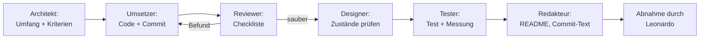

# Rollen und Agenten im Projekt

Dieses Projekt ist in mehreren Rollen entstanden, nicht in einem Durchlauf. Diese
Datei hält fest, **wer welche Aufgabe hat**, **was jede Rolle prüfen muss** und
**wann ein Schritt als abgenommen gilt**. Sie ist bewusst Teil des Repos: Ein
Reviewer soll sehen können, wo im Ablauf ein Mensch draufgeschaut hat — und wo
nicht.

Die Rollen sind als Agentenrollen beschrieben, weil ich so arbeite: Planung,
Umsetzung, Review und Design laufen als getrennte Durchgänge mit eigener
Checkliste, nicht als ein einziger Prompt. Technisch ist das gewöhnlicher Code in
einem Repo; die Rollen sind der Prozess drumherum.

## Die Rollen

### 1. Architekt (Planung)

**Aufgabe:** Umfang festlegen und die Entscheidungen treffen, die später teuer zu
ändern sind.

- Schneidet den Umfang so, dass ein Kern vollständig funktioniert statt vieles halb.
- Entscheidet Datenmodell: Chunk mit Seitenzahl, `vector(1536)`, Hybrid-Index.
- Benennt die Nicht-Ziele schriftlich (siehe README), bevor Code entsteht.
- Liefert pro Schritt eine kurze Aufgabenliste mit Abnahmekriterien.

**Muss prüfen:** Passt jede Aufgabe in einen Commit? Ist jede Entscheidung in
zwei Sätzen begründbar? Gibt es eine Alternative, die billiger wäre?

**Abgabe:** `docs/`, README-Abschnitte „Technische Entscheidungen" und
„Bewusste Nicht-Ziele".

### 2. Umsetzer (Implementierung)

**Aufgabe:** Die Schritte aus der Planung in Code bringen, ein Schritt pro Commit.

- Hält sich an `AGENTS.md` (TypeScript strict, kein `any`, SQL nur in `lib/db.ts`).
- Schreibt deutschen Code-Kommentar nur dort, wo die Absicht nicht aus dem Code
  hervorgeht — nicht als Nacherzählung jeder Zeile.
- Committet klein und sprechend: was geändert wurde und warum.
- Meldet offene Punkte, statt sie stillschweigend zu umgehen.

**Muss prüfen:** `npm run typecheck`, `npm run build`, `npm run lint` grün.

### 3. Reviewer (Code-Review)

**Aufgabe:** Gegenlesen, bevor ein Schritt als fertig gilt. Der wichtigste
Durchgang: Hier fliegen die Fehler raus, die eine Demo kaputt machen.

**Checkliste, die bei jedem Schritt abgearbeitet wird:**

- **Richtigkeit:** Tut der Code das, was der Commit behauptet? Gibt es einen Test,
  der das belegt — und wurde er wirklich ausgeführt?
- **Stille Fehler:** Wird irgendwo Text abgeschnitten, ein Fehler verschluckt,
  ein `catch` leer gelassen, ein Promise nicht awaited?
- **Datenintegrität:** Bleiben Seitenzahlen korrekt? Kann ein zweiter Ingest
  doppelte Chunks erzeugen? Räumt ein Löschen die Chunks mit auf?
- **Kosten und Grenzen:** Gibt es ein Limit für Dateigröße, Batch-Größe,
  Ausgabetokens? Was passiert bei einem 300-Seiten-PDF?
- **Sicherheit:** Keine Keys im Repo, keine Service-Role-Keys im Client,
  keine ungeprüften Dateitypen.
- **Lesbarkeit:** Würde ein fremder Entwickler die Datei in fünf Minuten
  verstehen? Gibt es `any`, toten Code, auskommentierte Reste?

Befunde werden als Liste festgehalten: was gefunden, was geändert, was bewusst
offen gelassen. Diese Liste ist der Beleg für die Abnahme.

### 4. Designer (UI und Lesbarkeit)

**Aufgabe:** Die Oberfläche so bauen, dass sie ohne Erklärung verständlich ist.

- Eine Hierarchie pro Bildschirm: Quellen links, Antwort rechts, Beleg direkt an
  der Aussage.
- Zustände sind Pflicht, nicht Zusatz: leer, lädt, Fehler, Erfolg. Jeder Schritt
  der Pipeline ist sichtbar, damit Verarbeitung nicht wie ein Hänger wirkt.
- Belege müssen auf einen Blick lesbar sein (Datei, Seite, Zitat), nicht als
  Fußnote am Ende.
- Kontrast und Schriftgrößen so, dass es auf einem Beamer im Vorstellungsgespräch
  noch lesbar ist.

**Muss prüfen:** Jeden Zustand einmal von Hand durchgeklickt, auf schmalem und
breitem Fenster.

### 5. Tester (Qualitätssicherung)

**Aufgabe:** Beweisen, dass es funktioniert — nicht behaupten.

- Ein Eval-Set aus Fragen mit erwarteter Seite (`docs/eval-plan.md`).
- Tests gegen eine echte Datenbank, nicht nur Typen.
- Grenzfälle: leeres PDF, gescanntes PDF, sehr langer Absatz, doppelter Upload.
- Trefferquote wird gemessen und im README genannt, auch wenn sie unangenehm ist.

### 6. Technischer Redakteur (Doku)

**Aufgabe:** Doku, die ein Reviewer in fünf Minuten versteht.

- README mit Architektur, Entscheidungen und ehrlichem Stand.
- Commit-Historie als lesbarer Weg, nicht als ein Sammel-Commit.
- Was nicht gebaut ist, steht unter Nicht-Zielen mit Begründung.

## Ablauf pro Schritt



Kein Schritt gilt als fertig, weil er kompiliert. Er gilt als fertig, wenn der
Reviewer die Checkliste abgearbeitet hat, der Test gelaufen ist und die Doku den
Stand ehrlich beschreibt.

## Was das für die Historie bedeutet

Die Commit-Reihenfolge folgt den Schritten, nicht den Dateien: erst Projekt und
Werkzeuge, dann Grundgerüst der Oberfläche, dann Datenmodell, dann die Logik in
der Reihenfolge, in der die Pipeline sie aufruft, zuletzt API und Doku.

## So laufen die Rollen in Cursor

Die Rollendateien liegen unter `.cursor/rules/` als `.mdc`-Dateien. Sie gelten
nicht automatisch in jedem Chat (`alwaysApply: false`), sondern werden bewusst
per `@` eingeblendet — etwa `@architekt` oder `@reviewer`. So bleibt jede Rolle
ein eigener Durchgang mit festem Kontext. Die Agenten diskutieren nicht
untereinander; ein Reviewer erbt nicht den Implementierungs-Chat.

Die verbindlichen Projektregeln stehen in `AGENTS.md` und gelten unabhängig von
der Rolle. Deshalb gibt es keine zusätzliche, immer aktive Projektregel, die
denselben Text wiederholen würde.

### Ablauf pro Schritt

```mermaid
flowchart TD
  A[Neuer Chat: @architekt plant] --> B[Leonardo gibt den Plan frei]
  B --> C[Neuer Chat: @umsetzer baut]
  C --> D[Frischer Chat: @reviewer prüft nur Plan und Diff]
  D -->|Befund| C
  D -->|sauber| E[@designer prüft die Oberfläche]
  E --> F[Neuer Chat: @tester führt Tests und die vier Checks aus]
  F --> G[@redakteur aktualisiert die Doku]
  G --> H[Leonardo nimmt im Pull Request ab]
```

1. Neuer Chat, `@architekt` und die Schritt-Nummer. Ergebnis:
   `docs/schritt-N-plan.md`.
2. Leonardo liest den Plan und gibt ihn frei — oder schickt ihn zurück.
3. Neuer Chat, `@umsetzer` plus den freigegebenen Plan. Bauen und in kleinen
   Commits festhalten.
4. **Frischer** Chat, `@reviewer`, nur Plan und Diff. Protokoll nach
   `docs/review-schritt-N.md`. Bei Funden zurück zum Umsetzer, wieder in einem
   eigenen Chat.
5. `@designer` prüft Hierarchie, Zustände und Belege auf schmalem und breitem
   Fenster.
6. Neuer Chat, `@tester`: Tests schreiben oder prüfen, danach `typecheck`,
   `lint`, `test` und `build` wirklich ausführen.
7. `@redakteur` zieht README und `docs/` auf den ehrlichen Stand.
8. Leonardo nimmt im Pull Request ab. Keine Rolle merged, deployt oder ändert
   den Systemprompt in `lib/prompt.ts` ohne seine Freigabe. `@abnahme` darf nur
   die Prüfliste vorbereiten, nie selbst für abgenommen erklären.

### Beispiel-Prompts

**Architekt**

```
@architekt Plane Schritt 2 (Ingest) gemäß AGENTS.md und dem README.
Schreib den Plan nach docs/schritt-2-plan.md. Noch nicht umsetzen.
```

**Umsetzer**

```
@umsetzer Setze den freigegebenen Plan in docs/schritt-2-plan.md um.
Kleine, sprechende Commits. Nicht mergen, nicht deployen.
```

**Reviewer**

```
@reviewer Dies ist ein frischer Chat. Du bekommst nur den Plan
docs/schritt-2-plan.md und den Diff dieses Branches gegen die Basis.
Prüfe gegen AGENTS.md. Jeden Fund mit Datei, Zeile und Schweregrad
nach docs/review-schritt-2.md schreiben. Keinen Code ändern.
```

**Designer**

```
@designer Prüfe die Oberfläche auf Zustände (leer, lädt, Fehler, Erfolg),
Belegkarten und Lesbarkeit auf schmalem und breitem Fenster.
```

**Tester**

```
@tester Prüfe und ergänze die Tests zu diesem Schritt. Führe
npm run typecheck, lint, test und build aus und halte das Ergebnis fest.
```

**Redakteur**

```
@redakteur Aktualisiere README und docs/ auf den ehrlichen Stand dieses
Schritts. Nichts als fertig darstellen, was noch fehlt.
```

**Abnahme (nur Prüfliste, kein Merge)**

```
@abnahme Bereite die Abnahme-Prüfliste vor: Review-Protokoll, CI, Doku,
offene Blocker. Nicht mergen, nicht für abgenommen erklären.
```
