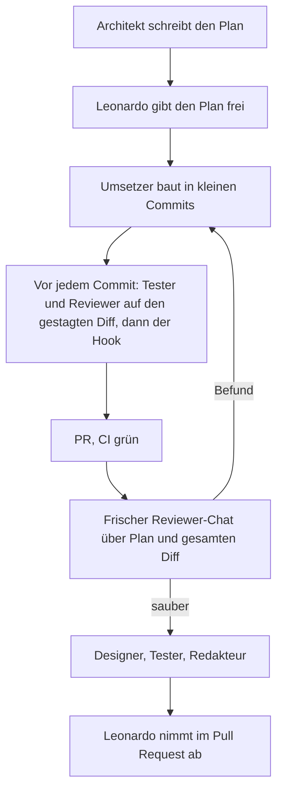

# Vorgehen

Dieses Projekt ist in getrennten Rollen entstanden, nicht in einem Durchgang.
Die Datei hält fest, **wie** geplant, gebaut und geprüft wurde — mit Belegen
aus der Historie, den Pull Requests und den Review-Protokollen. Sie ist
absichtlich Teil des Repos: Ein Reviewer soll sehen können, wo ein Mensch
entschieden hat, und wo ein Review oder ein Live-Test etwas gefunden hat.

Die verbindlichen Regeln stehen in [`AGENTS.md`](../AGENTS.md). Die Rollen
und der Soll-Ablauf sind in [`docs/agents.md`](agents.md) beschrieben, die
ausführbaren Checklisten unter [`.cursor/rules/`](../.cursor/rules/) als
`.mdc`-Dateien. Gemessene Trefferquote und Kalibrierung der Absage-Schwelle
sind Schritt 4; die Zahlen folgen in [`eval/ergebnisse.md`](../eval/ergebnisse.md).

## Die Rollen

Sieben Rollen, bewusst per `@` in Cursor eingeblendet (`alwaysApply: false`).
Sie gelten nicht in jedem Chat von selbst, damit Planung, Umsetzung und
Review eigene Durchgänge bleiben und nicht zu einem Prompt verschmelzen.
Die Agenten diskutieren nicht untereinander.

| Rolle | Datei | Aufgabe |
| --- | --- | --- |
| Architekt | `architekt.mdc` | Umfang und teure Entscheidungen, Plan nach `docs/schritt-N-plan.md` |
| Umsetzer | `umsetzer.mdc` | den freigegebenen Plan in kleine, sprechende Commits bringen |
| Reviewer | `reviewer.mdc` | Checkliste gegen den gestagten Diff und am Schrittende gegen Plan plus gesamten Diff |
| Tester | `tester.mdc` | Tests schreiben oder prüfen, `typecheck`, `lint`, `test` und `build` wirklich ausführen |
| Designer | `designer.mdc` | Hierarchie, Zustände und Belege prüfbar machen, auch auf schmalen Fenstern |
| Redakteur | `redakteur.mdc` | README und `docs/` auf den ehrlichen Stand ziehen |
| Abnahme | `abnahme.mdc` | nur Leonardos Prüfliste vorbereiten, nie selbst mergen oder für abgenommen erklären |

Keine Rolle merged, deployt oder ändert den Systemprompt in `lib/prompt.ts`
ohne Freigabe. Das steht in den Rollendateien und in `docs/agents.md`.

## Ablauf eines Schritts



So ist es tatsächlich gelaufen, mit Belegen:

1. **Plan.** `@architekt` schreibt `docs/schritt-N-plan.md` mit Aufgaben, die
   später einzelne Commits werden, begründeten Entscheidungen und
   Abnahmekriterien. Schritt 2: [`docs/schritt-2-plan.md`](schritt-2-plan.md),
   PR [#4](https://github.com/leorifa93/notebook/pull/4). Schritt 3:
   [`docs/schritt-3-plan.md`](schritt-3-plan.md), als eigener PR
   [#6](https://github.com/leorifa93/notebook/pull/6) freigegeben, bevor Code
   entstand.
2. **Freigabe.** Erst danach beginnt die Umsetzung. In Schritt 3 sind
   Leonardos Entscheidungen vom 10.11.2026 im Plan festgehalten
   (`ac4a9c2`).
3. **Kleine Commits.** Ein Commit ist eine in einem Satz erklärbare Änderung,
   auf Deutsch, ohne `wip` und ohne `fix` als Präfix (`AGENTS.md`). Auf
   `main` liegen 88 solche Commits plus die Merge-Commits der PRs.
4. **Review und Test vor dem Commit.** Seit PR
   [#10](https://github.com/leorifa93/notebook/pull/10) ruft der Umsetzer
   vor jedem Commit `@tester` und `@reviewer` auf den gestagten Diff auf
   und behebt Befunde, bevor der Commit entsteht. Ein Pre-commit-Hook
   erzwingt zusätzlich die automatischen Prüfungen.
5. **Pull Request, dann Abnahme.** Die CI muss grün sein. Leonardo reviewed
   und merged selbst. Beispiele, in denen der Review im PR etwas geändert
   oder einen Folge-PR ausgelöst hat, stehen unten.

Am Ende eines Schritts kommt ein **frischer** Reviewer-Chat dazu: nur Plan
und gesamter Diff, Protokoll unter `docs/review-schritt-N.md`. Dieser Blick
darf nicht denselben Chat erben, in dem umgesetzt wurde.

## Hook und CI

Der Hook (Husky 9.1.7, `.husky/pre-commit`, eingeführt in PR #10) führt aus:

```bash
npm run typecheck && npm run lint && npm test
```

`--no-verify` ist verboten. Das `prepare`-Script ist `husky || true`, damit
`npm ci` in der CI und auf Vercel ohne `.git` nicht bricht. In PR #10 ist
festgehalten, dass ein absichtlicher Typfehler den Commit mit Exit 2
abgebrochen hat, und dass ein Lauf damals etwa 8 Sekunden dauerte (151 Tests).

Die GitHub-Action [`.github/workflows/ci.yml`](../.github/workflows/ci.yml)
führt bei jedem Pull Request und jedem Push auf `main` dieselben drei
Befehle plus `npm run build` aus, ohne Secrets: Der Build braucht weder
`DATABASE_URL` noch `OPENAI_API_KEY`. Auf `main` nach PR
[#15](https://github.com/leorifa93/notebook/pull/15) sind das 285 Tests in
19 Dateien.

## Was Review und Live-Test gefunden haben

Nicht jeder Fund kam aus einem Rollendurchgang. Die schwersten Fehler in
der Demo kamen beim echten Upload und beim echten Chat.

### L1 — NUL-Bytes aus einem PDF (Live, PR #5)

Ein Lebenslauf-PDF ließ sich live nicht speichern: „Die Quelle konnte nicht
gespeichert werden.“ Im Vercel-Log stand `invalid byte sequence for encoding
"UTF8": 0x00`. pdf.js liefert bei manchen PDFs (etwa aus Word) NUL-Bytes,
Postgres lehnt U+0000 in `text`-Spalten ab. Die Tests hatten das nicht
gesehen, weil die Fixtures keine NUL-Bytes enthielten.

Behoben in PR [#5](https://github.com/leorifa93/notebook/pull/5): Steuerzeichen
werden entfernt, bevor der Text ins Chunking geht. Ein Test gegen PGlite
schlägt ohne den Filter mit genau diesem Live-Fehler fehl. Dieselbe Falle
tauchte in Schritt 3 über das Eingabefeld wieder auf (Auffälligkeit 7 im
Plan) und wurde dort in der Chat-Route geschlossen — belegt in
[`docs/review-schritt-3.md`](review-schritt-3.md).

### Falsche PR-Basis — #7 landete nicht auf `main`

PR [#7](https://github.com/leorifa93/notebook/pull/7) (Chat-Backend, Teil 3a)
hatte als Basis `plan/schritt-3-chat`, den Plan-Branch aus PR #6. Nach dem
Merge von #6 wurde die Basis nicht auf `main` umgestellt. #7 wurde deshalb
in den Plan-Branch gemergt, nicht nach `main`. PR
[#8](https://github.com/leorifa93/notebook/pull/8) hat genau diese Commits
nachträglich auf `main` gebracht, ohne neue Änderungen. Das Chat-Backend war
bis dahin weder auf `main` noch in Production.

### F1 und F2 — frischer Review vor der Oberfläche (PR #9, behoben in #11)

Teil 3a war zuerst im selben Durchgang umgesetzt und gegen den eigenen Diff
geprüft worden. Das ist kein frischer Blick, und `docs/review-schritt-3.md`
sagt das offen. Danach lief `@reviewer` in einem eigenen Chat über Plan und
gesamten Diff (PR [#9](https://github.com/leorifa93/notebook/pull/9)): kein
Blocker, aber zwei wichtige Funde.

**F1.** Nutzt die Vektorsuche den HNSW-Index, filtert pgvector
`document_id = ANY(…)` erst nach dem Index-Scan (`hnsw.ef_search = 40`).
Liegen die 40 nächsten Chunks in abgewählten Dokumenten, kommt kein
Vektortreffer, und der Chat sagt still ab, obwohl die kleine, angehakte
Quelle passt. In den Tests fiel das nicht auf, weil PGlite bei wenig Daten
sequenziell scannt. Behoben in PR
[#11](https://github.com/leorifa93/notebook/pull/11) mit
`SET LOCAL hnsw.iterative_scan = relaxed_order` in derselben Transaktion.
Der Regressionstest (300 nähere Chunks in der großen Quelle, gesucht nur in
der kleinen) war ohne den Fix rot.

**F2.** Ein falsches Datenbank-Passwort, ein fehlendes Schema oder ein
Zertifikatsfehler galten als vorübergehend und kamen als 500 mit „Bitte
versuche es erneut.“ Genau so haben sich die Konfigurationsfehler an diesem
Tag live angefühlt. Seit PR #11 sind das 503 ohne Retry-Hinweis, in Chat,
Upload und Quellenliste. Timeouts und Verbindungsabbrüche bleiben bewusst
vorübergehend. Der alte Test hatte das vorherige Verhalten festgeschrieben
und wurde umgeschrieben; ohne den Fix waren 17 Tests rot.

### L2 — doppelter PDF-Text, deshalb merkwürdige Belege (Live, PR #13)

Nach dem Merge der Chat-Oberfläche (PR
[#12](https://github.com/leorifa93/notebook/pull/12)) wirkten die Belege am
Lebenslauf mal richtig, mal endlos wiederholt. Die Oberfläche war unschuldig:
Sie zeigte genau die `[n]` aus dem Stream. Die Ursache lag im Einlesen.

`parsePdf` lieferte 29.458 Zeichen, `pdftotext` rund 20.000. Zwei
Mechanismen: Textstücke waren deckungsgleich doppelt gezeichnet, und ein
Abschnitt lag ein zweites Mal versetzt in der Textebene, im Bild unsichtbar.
Ergebnis: 12 Chunks statt 5, Chunk-Paare bis 92 % deckungsgleich. Die Suche
lieferte Kopien, das Modell belegte mit `[1][2][3][4][5]`, und die Karte
zeigte den Anfang eines langen Chunks statt der zitierten Stelle.

PR [#13](https://github.com/leorifa93/notebook/pull/13), vier Commits, jeder
mit einem Test, der ohne den Fix rot war: doppelten Text verwerfen, fast
gleiche Treffer entfernen, höchstens zwei Belege pro Aussage und kein
Markdown (Systemprompt, von Leonardo freigegeben), Ausschnitt an der zur
Frage passenden Stelle. Gemessen am selben Lebenslauf:

| | vorher | nachher |
| --- | --- | --- |
| Zeichen nach dem Einlesen | 29.458 | 10.591 |
| Chunks | 12 | 5 |
| größte Überdeckung zweier Chunks | 92 % | 28 % |
| `[n]` bei der Frage nach Technologien | 20 | 8 |
| Markdown-Sternchen in einer Antwort | 24 | 0 |

### E1–E3 — unsaubere Eingaben bis in die Suche (PR #15)

Die Abschluss-Tests von Schritt 3 haben drei Fehler gefunden, die seit
Schritt 2 im Code waren:

- **E1.** Ein NUL-Byte im Dateinamen führte zu einer 500 mit Retry-Hinweis.
  Ein Name nur aus unsichtbaren Zeichen ergab einen unsichtbaren Titel.
- **E2.** Weiche Trennzeichen oder Nullbreiten-Leerzeichen mitten im Wort
  machten das Wort für die deutsche Volltextsuche unauffindbar.
- **E3.** Zerlegte Umlaute von Mac-Dateien (NFD) speicherte die Datenbank
  anders als die getippte Frage (NFC).

Behoben über ein gemeinsames `cleanText()` für Inhalt, Titel und Frage.
12 der 18 neuen Tests waren ohne den Fix rot. Festgehalten in
[`docs/review-schritt-3.md`](review-schritt-3.md).

Andere Funde, kürzer: In Schritt 1 schnitt das Chunking überlange Absätze
still ab (827 Wörter weg), und die Volltextsuche verknüpfte alle Wörter mit
UND. In Schritt 2 fand der Review doppelte Uploads (R1), fehlende
Mengenlimits für Text (R2) und fehlende Row Level Security (R3); der Tester
fand eine ungefangene `error`-Event-Quelle am Pool (T1). Die Pro-Commit-Reviews
in Teil 3b haben unter anderem rohe JSON-Fehler im Chat (U2), einen falsch
wirkenden Abbruch (U3) und Modelltext aus den Quellen in den Logs (Z1) vor
dem Push abgefangen. Das steht in den jeweiligen Review-Protokollen.

## Was die Rollen verpasst haben

Der Prozess hat nicht alles zuerst gesehen. Das gehört hierher, nicht nur
die Erfolge.

- **L2 fiel keiner Rolle auf.** Alle Tests liefen gegen selbst erzeugte
  PDFs, in denen jeder Text genau einmal gezeichnet ist. Der Tester prüfte
  „kein Textverlust“, aber nie „kein Text zu viel“. Der Reviewer las den
  Diff, nicht die Daten eines echten Exports. Eine Kopie fällt erst auf,
  wenn man den Roh-Stream mit `pdftotext` vergleicht.
- **E1–E3 waren seit Schritt 2 im Code.** F3 im frischen Review hatte
  unsichtbare Zeichen nur als Risiko für die Tag-Grenze im Prompt gesehen,
  nicht als Grund, warum die Suche ein Wort nicht findet. Gefunden hat sie
  erst der gezielte Test mit unsauberen Eingaben.
- **F1 war in den Unit-Tests unsichtbar**, weil PGlite den HNSW-Pfad nicht
  von allein nimmt. Der frische Review hat den Index gelesen, nicht nur den
  Test-Output — genau deshalb gibt es ihn.
- **Teil 3a wurde im selben Chat reviewed, in dem er gebaut wurde.** Die
  Befunde S1–S3 kamen so noch vor dem PR, aber es war kein unabhängiger
  Blick. Leonardos Vorgabe danach: Review und Test vor jedem Commit, plus
  der frische Durchgang am Schrittende.
- **Die dokumentierte Prozessänderung zu L1 ist nicht vollständig auf
  `main` gelandet.** Die Beschreibung von PR #5 kündigt den Prüfpunkt
  „Externer Text“ in `reviewer.mdc`, „unsauberer Input bis in die DB“ in
  `tester.mdc` und einen Abschnitt in `docs/review-schritt-2.md` an. Die
  zugehörigen Commits liegen auf `fix/steuerzeichen-im-text` und sind
  nicht in `main`. In den Rollendateien auf `main` steht der L1-Punkt
  deshalb nicht. Die Lehre selbst ist über den Plan (Auffälligkeit 7) und
  die Tests in Schritt 3 trotzdem eingeflossen.

## Was sich am Prozess geändert hat

Jeder dieser Funde hat eine schriftliche Konsequenz, nicht nur einen Fix
im Code.

- Nach **L1** stand die Lehre im Plan von Schritt 3: unsauberen Input bis
  in die Datenbank testen, nicht nur saubere Fixtures. Nach **E1–E3** gilt
  dasselbe noch einmal für Dateiname, unsichtbare Zeichen und Normalisierung.
- Nach dem Review von **Teil 3a im selben Durchgang** kamen Hook und
  Pflicht-Review vor jedem Commit (PR #10, festgehalten in `docs/agents.md`
  und `AGENTS.md`) und der frische Reviewer-Chat vor der Oberfläche (PR #9).
- Nach **L2** haben Reviewer- und Tester-Checkliste auf `main` neue Punkte:
  kein doppelter Text innerhalb eines Dokuments, Belege an der tragenden
  Stelle und gegeneinander verschieden, Prüfung echter Exporte gegen
  `pdftotext` („kein Text zu viel“, nicht nur „kein Textverlust“).
- Nach der **falschen PR-Basis** von #7 gilt praktisch: Vor dem Merge
  prüfen, ob die Basis wirklich `main` ist, sobald der Vorgänger-PR
  gelandet ist.

Was bewusst offen bleibt (F3-Rest, F5–F8, S4, S6/R9, Safari und `#page`,
gesperrte Überschriften), steht im README unter „Bekannte Grenzen“ und am
Ende von [`docs/review-schritt-3.md`](review-schritt-3.md).
